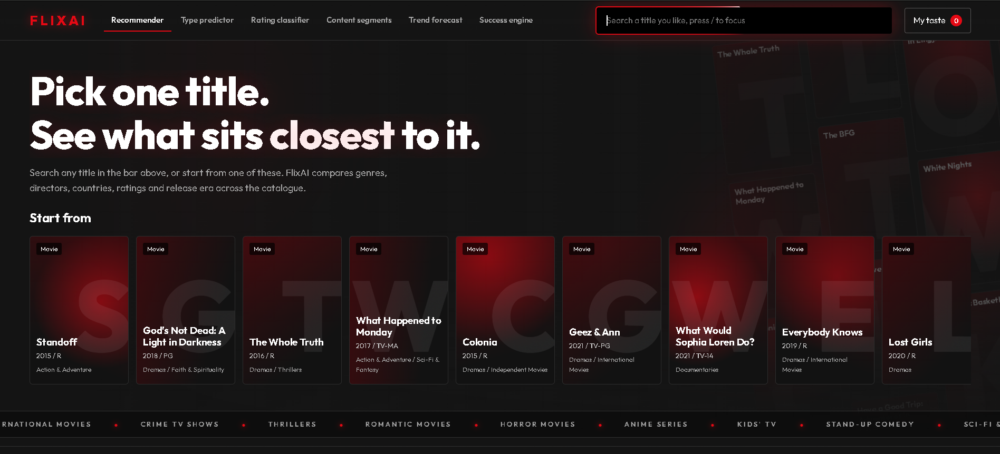
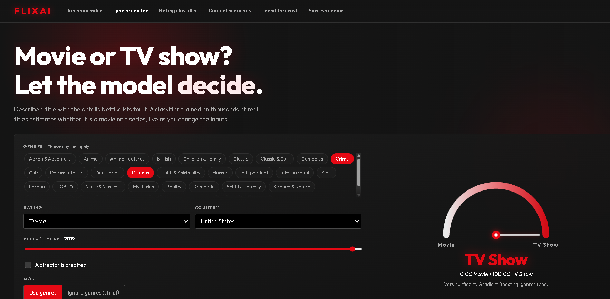
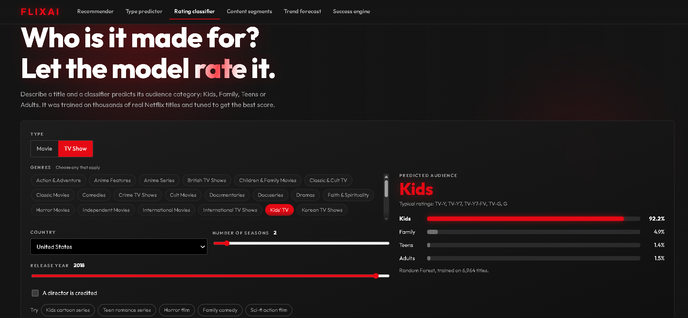
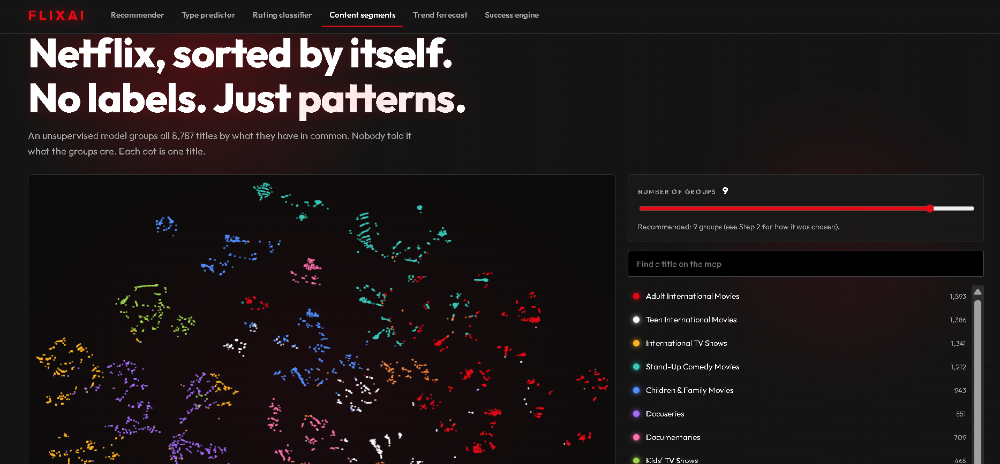
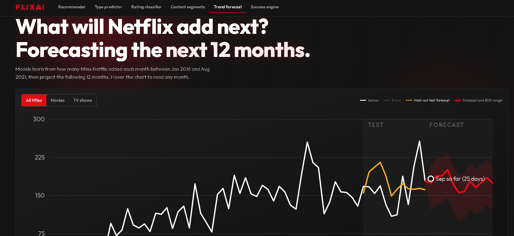
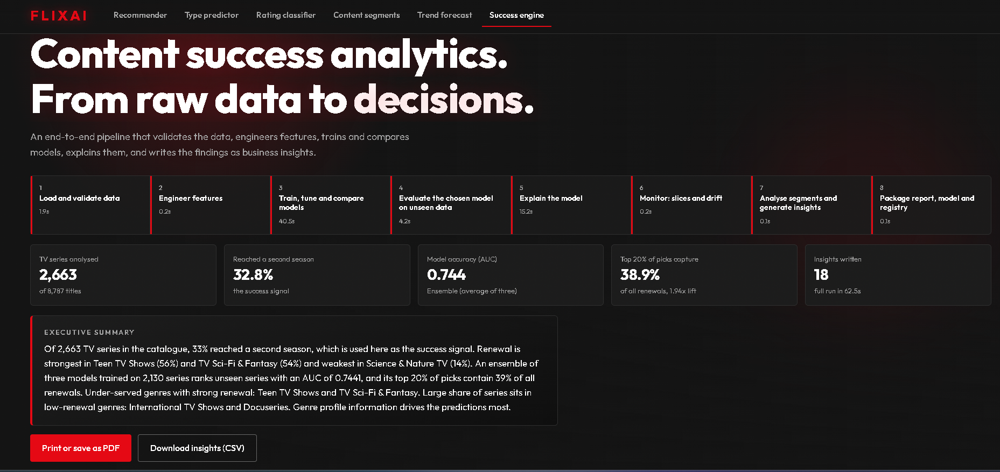

# FlixAI: Netflix Machine Learning Projects

Six machine learning projects on the Netflix catalogue, delivered through one website with a Netflix-style design (red `#E50914`, black `#141414`, white).
Built for the **Auspify Technologies Machine Learning Internship**. The program asks for any 4 of 6 tasks. All 6 are completed.



## What is inside

| # | Task | Kind of problem | Models and methods | Result | Code | Website tab |
|---|------|-----------------|--------------------|--------|------|-------------|
| 1 | Content Recommendation System | Content-based similarity | Count and TF-IDF vectors, weighted features, cosine similarity | Top-10 lists share a genre 100% of the time (random picks 24.4%); 68.4% of titles can be recommended | `ml/recommender.py` | Recommender |
| 2 | Content Type Prediction | Binary classification | Logistic Regression, Decision Tree, Random Forest, Gradient Boosting | 98.7% (realistic) and 94.8% (strict) against 69.7% for always guessing Movie | `ml/type_model.py` | Type predictor |
| 3 | Audience Rating Classification | Multi-class classification (Kids, Family, Teens, Adults) | The same four models with randomized hyperparameter tuning | Random Forest: 62.8% accuracy, macro F1 0.615, against a 46.0% baseline | `ml/rating_model.py` | Rating classifier |
| 4 | Content Segmentation | Unsupervised clustering | K-Means, Agglomerative, Gaussian Mixture, PCA, t-SNE | 9 content groups, silhouette 0.199 | `ml/cluster_model.py` | Content segments |
| 5 | Trend Forecasting | Time-series forecasting | 9 models: baselines, Holt-Winters, Ridge, Random Forest, Gradient Boosting, ensemble | Forecast of 2,116 titles added over the next 12 months (+7.3%) | `ml/forecast_model.py` | Trend forecast |
| 6 | Content Success Analytics Engine | End-to-end pipeline with MLOps | Logistic Regression, Random Forest, Gradient Boosting, ensemble | AUC 0.744; the top 20% of picks capture 38.9% of renewals; 18 automatic insights | `ml/engine.py` | Success engine |

## Screenshots

| Task 2: Type predictor | Task 3: Rating classifier |
|---|---|
|  |  |

| Task 4: Content segments | Task 5: Trend forecast |
|---|---|
|  |  |

| Task 6: Success engine |
|---|
|  |

## Features

- **Recommender:** search with suggestions, poster rows with match percentages and reasons, an animated similarity map, and a "My taste" mode that blends up to five liked titles.
- **Type predictor:** a live gauge that updates as you describe a title, a strict mode that ignores genres, and a tester on titles the models never saw.
- **Rating classifier:** live probabilities for four audience groups, default versus tuned model comparison, and a decision tree depth curve that shows overfitting.
- **Content segments:** an interactive map of all titles with a slider for the number of groups, a title finder, and group cards with a comparison heatmap.
- **Trend forecast:** a forecast chart with hold-out test and 80% range, switchable between all titles, movies and TV shows, plus a CSV download.
- **Success engine:** pipeline stages, automated business insights with confidence levels, a what-if scorer for series concepts, model comparison, and an MLOps panel. The page can be printed or saved as PDF.

## Technology

Python 3, pandas, NumPy, SciPy, scikit-learn, Flask, HTML, CSS and JavaScript (no front-end framework). The whole website is one file.

## Project structure

```
flixai/
├── app.py                  Flask server and API for all six tasks
├── requirements.txt        Python libraries
├── README.md
├── data/
│   └── Dataset.xlsx        Netflix catalogue
├── ml/
│   ├── recommender.py      Task 1: features, similarity, evaluation
│   ├── type_model.py       Task 2: movie or show classifiers
│   ├── rating_model.py     Task 3: rating category classifiers and tuning
│   ├── cluster_model.py    Task 4: clustering and the 2D map
│   ├── forecast_model.py   Task 5: time features and forecasting
│   ├── engine.py           Task 6: end-to-end analytics pipeline
│   └── *_metrics.json      Results created by the scripts and read by the website
├── static/
│   └── index.html          The whole website (HTML, CSS and JavaScript)
└── docs/
    ├── FlixAI_ML_Internship_Report.docx   Full report explaining every task
    └── screenshots/
```

## Getting started

Requires Python 3.10 or newer (developed with Python 3.12 and scikit-learn 1.8).

```bash
git clone <your-repository-url>
cd flixai
pip install -r requirements.txt

# Train the models. Run at least the first one before starting the server.
python ml/recommender.py     # Task 1 (seconds)
python ml/type_model.py      # Task 2 (1 to 2 minutes)
python ml/rating_model.py    # Task 3 (about 3 minutes)
python ml/cluster_model.py   # Task 4 (about 2 minutes)
python ml/forecast_model.py  # Task 5 (about 30 seconds)
python ml/engine.py          # Task 6 (about 2 minutes)

python app.py                # then open http://127.0.0.1:5000
```

Open the tabs at the top of the page to move between tasks. If a model has not been trained yet, its tab says which command to run. Trained models (`*.pkl`) are not stored in the repository, so each script builds its own.

## How each task works

**Task 1: Recommendation.** Each title becomes a weighted vector: genres (weight 5.0), director (1.2), country (1.0), type (1.0), rating (0.5), release decade (0.4) and length (0.4). Directors and countries use TF-IDF so rare names count more. Cosine similarity ranks the closest titles. Evaluated on 1,500 random titles. Genre scores are partly circular because genres are an input, so a random baseline is shown too.

**Task 2: Type prediction.** Duration ("90 min" or "2 Seasons") gives the answer away, and Netflix uses different genre names for movies and shows. The models are therefore compared in four setups: all features, without duration, with neutral genre names (realistic), and without genres (strict). With 5-fold cross-validation and a final 20% hold-out, the strict model still reaches about 95%, mostly because TV shows rarely list a director.

**Task 3: Rating classification.** The 14 raw ratings are grouped into Kids, Family, Teens and Adults (82 unrated titles removed). Four models are tuned with `RandomizedSearchCV` (scored on macro F1) and the best one by cross-validation is tested once on unseen titles. Family and Teens are the hardest groups.

**Task 4: Segmentation.** Numbers are scaled, categories encoded and weighted, and PCA keeps 85.7% of the information (69 columns become 21). K-Means is run for k = 2 to 12. The number of groups is chosen as the best silhouette between 4 and 10 where every group holds at least 3% of titles (k = 9). K-Means beats Agglomerative and Gaussian Mixture on all three quality measures. The 2D map uses t-SNE for display only.

**Task 5: Forecasting.** The target is the number of titles added each month (January 2016 to August 2021, 68 months). Features are calendar terms, lags (1, 2, 3, 12) and rolling averages. Nine models are compared with rolling-origin backtests and a final 12-month hold-out. The 80% range comes from the model's own past errors. On the final year a simple moving average beat the model chosen by the backtest, because the series changed behaviour around 2020. The website says so openly.

**Task 6: Success analytics engine.** The dataset has no viewing data, so "success" is a proxy: a TV series that reaches a second season (33% of 2,663 series). The number of seasons is never used as an input. One command validates the data, engineers features (out-of-fold target encoding, genre rarity, timing features), tunes and compares models, explains them (permutation importance, what-if effects), writes insights automatically with confidence levels, checks drift and slices, saves a versioned model and updates a model registry. A new model only replaces production if its test AUC is within 0.005 of the current one.

## API

| Task | Endpoints |
|------|-----------|
| 1 | `/api/search`, `/api/recommend/<id>`, `/api/taste`, `/api/popular`, `/api/metrics` |
| 2 | `/api/type/predict`, `/api/type/random`, `/api/type/titles`, `/api/type/metrics` |
| 3 | `/api/rating/predict`, `/api/rating/random`, `/api/rating/titles`, `/api/rating/metrics` |
| 4 | `/api/cluster/points`, `/api/cluster/metrics` |
| 5 | `/api/forecast/metrics` |
| 6 | `/api/engine/report`, `/api/engine/score`, `/api/engine/options` |

## Good practice used

- A test set that models never see, cross-validation for model choice, and a baseline for every task.
- Checks for data leakage and honest notes wherever a score needs context.
- Fixed random seeds (`random_state=42`) so results repeat.
- The same function builds features for training and for live scoring (Task 6).

## Limitations

- The dataset holds metadata only: no plots, cast, budgets, viewing hours or reviews.
- Task 1 genre scores are partly circular, and Task 2 scores are inflated by type-specific genre names.
- Task 4 groups are tendencies (silhouette about 0.2), not hard boundaries.
- Task 5 has only 68 months of history, and 2020 changed the pattern.
- Task 6 uses a proxy for success, and licensed series can inflate the season count.

## Future work

Add plot descriptions for text-based similarity, replace the success proxy with viewing or retention data, add real posters through a movie database API, and deploy the site with scheduled retraining.

## Report

A full written report that explains every task, model and result in plain language is in [`docs/FlixAI_ML_Internship_Report.docx`](docs/FlixAI_ML_Internship_Report.docx).

## Author

**[Your Name]**, Machine Learning Intern at Auspify Technologies. [LinkedIn](https://www.linkedin.com/in/your-profile)

`#Auspify` `#AuspifyTechnologies` `#AuspifyInternship` `#AuspifyProjects`

## Notes

Built for learning and the Auspify internship. The dataset is the Netflix titles file supplied with the internship.
